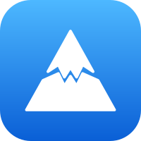
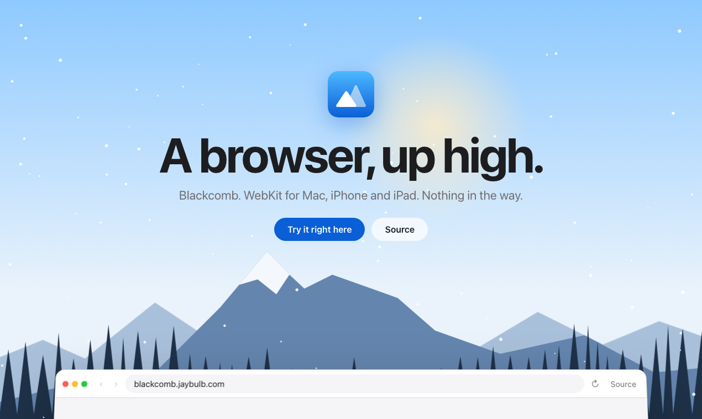

 

A WebKit browser for Mac, iPhone and iPad, named after the mountain above Whistler. Live at [blackcomb.jaybulb.com](https://blackcomb.jaybulb.com).



## Features

- **Reading list.** Save a page, read it offline in a plain reader, or have it read aloud.
- **Float (Mac).** Pop a tab into a small see-through window that stays above every app.
- **Pair (iPhone, iPad).** Two pages in one window.
- **Site rules.** Per-site zoom, dark mode, and blocks for images, scripts and pop-ups.
- **Automation (Mac).** Off by default. An AI agent can drive it over MCP or REST on 127.0.0.1, with a token.
- Private tabs, bookmarks, history, find in page, tracker blocking. Nothing leaves the device.

## Run

```
cd ios && xcodegen && open Blackcomb.xcodeproj
```

## License

MIT
