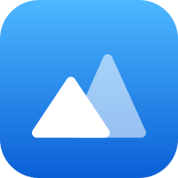
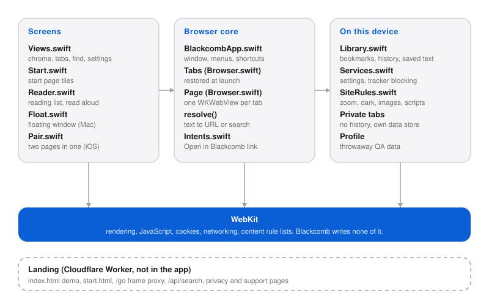

# blackcomb

 

A web browser is a text field and a WebKit view. Everything else is opinion. Named after the mountain above Whistler.

Blackcomb is a WebKit browser with four things Safari does not do.

**Reading list (both).** Save a page and its text stays on the device. Read it later without a connection in a plain reader with your own text size, or have it read aloud. A new tab opens on a start page with your reading list, bookmarks and recent pages, not a search engine.

**Float (Mac).** Shift-Command-F pops the current tab into a small window that stays above every other app on every Space and never takes focus. Slide it see-through, turn on click-through so your mouse passes straight to what is underneath, and get back with Option-Command-F or the Blackcomb icon in the menu bar. It remembers its size and place.

**Pair (iPhone and iPad).** Two pages in one window, side by side on iPad and in landscape, stacked in portrait. Each has its own address bar and back and forward, with a swap button and a divider you drag.

**Site rules (both).** Per-site page zoom, dark appearance, block images, block scripts and block pop-ups, kept on the device and applied through WebKit.

**Automation (Mac).** Turn it on in Settings and an AI agent can drive Blackcomb over MCP or a small REST API: open tabs, navigate, read the page, click, type, run JavaScript, take a screenshot. It listens on 127.0.0.1 only, needs a token, is off by default and never touches private tabs. The address bar glows while an agent is driving. Connect Claude Code with the command Settings copies for you:

```
claude mcp add --transport http blackcomb http://127.0.0.1:47329/mcp --header "Authorization: Bearer <token>"
```

REST is the same tools: `GET /api` lists them, `POST /api/<tool>` runs one.

There are also tabs, private tabs, bookmarks, history, find in page, tracker blocking and a Shortcuts action, Open in Blackcomb (and Open in Float Window on the Mac). Nothing is sent anywhere.


## Architecture



## Run

```
cd ios && xcodegen && open Blackcomb.xcodeproj
```

## License

MIT
